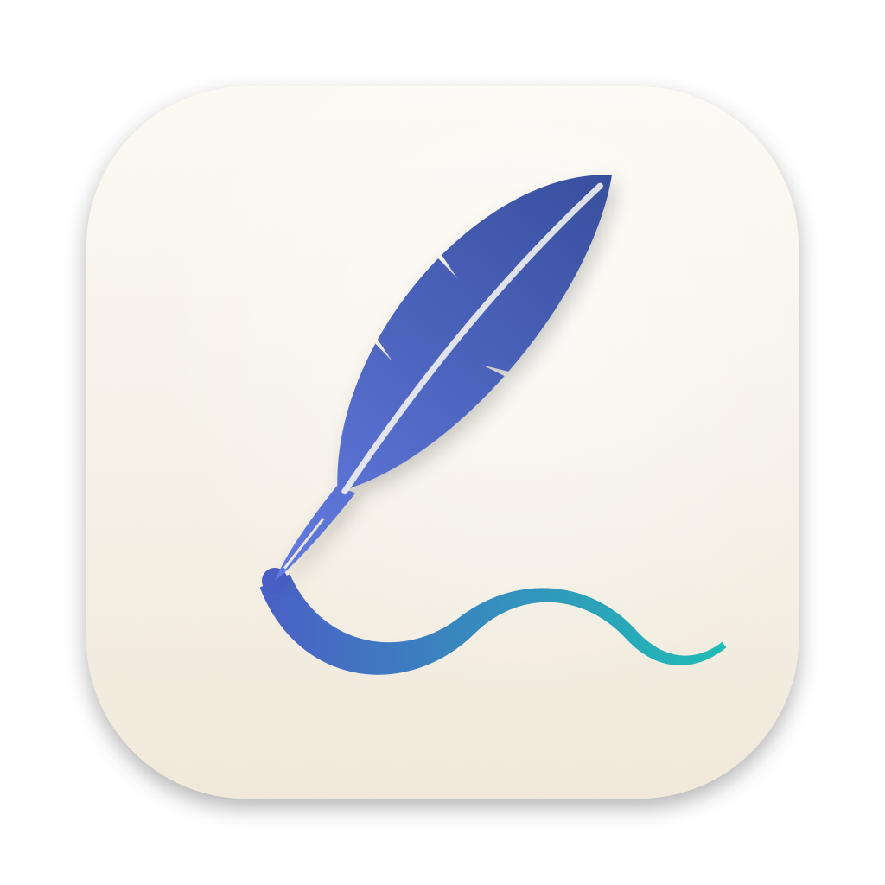

<p align="center"></p>

# 随声

**Mac 本地实时字幕**：抓取系统正在播放的声音（视频、剧集、直播、播客、歌曲），实时生成**英文 / 普通话 / 粤语**字幕，可选把粤语、英文**翻译成普通话**。识别和翻译全部在本机完成，声音和文字不会上传。

*Echo — on-device live captions for macOS (English / Mandarin / Cantonese), with optional translation to Mandarin. Apple Silicon only.*

- 菜单栏一键开关，屏幕底部悬浮字幕（置顶、鼠标穿透、全屏可见）
- 按说话停顿断句；粤语口语字（咗、哋、喺、嘅）照样写得出；说话 / 歌曲两种模式
- 每句定稿后用更准的模型精修；人名热词按拼音 / 粤拼近音纠正
- 输出简体（可选港繁 / 台繁），字幕记录按天保存

## 安装（普通用户）

从 [Releases](https://github.com/yaw0110/suisheng/releases) 下载 `Suisheng-<版本>.dmg`，打开后把「随声」拖进「应用程序」。

1. 首次打开若提示“无法验证开发者”：到「系统设置 → 隐私与安全性」点“仍要打开”（本 App 为免费签名，只需一次）。
2. 首次打开会自动安装运行环境和「实时识别」模型（共约 370MB，默认走国内镜像，需几分钟）。
3. 点菜单栏的羽毛笔图标开始字幕；第一次会请求“录制系统声音”权限，请允许。

要求：Apple 芯片（M1 及以后）、macOS 14.2+。内存：只用实时识别 8GB；开 Qwen 精修建议 16GB；再开翻译建议 24GB。
详细说明见 [packaging/安装说明.txt](packaging/安装说明.txt)。

## 工作原理

```
菜单栏 App（Swift：app/main.swift · ModelWindow.swift · Capture.swift）
  │  Capture.swift：Core Audio Tap 抓系统声音（编入 vendor/audiotee 的 AudioTeeCore）→ 16k PCM ─┐
  └─ python -m livecaption --audio-stdin --parent-pid <App PID>    ← 管道 ←──────────────────────┘
       ├─ audio.py       音频源：标准输入（App）/ audiotee 命令行（run.sh）/ wav 文件（测试）
       ├─ captioner.py   [识别线程] SenseVoice 每 ~0.3 秒对未定稿音频整体重识别 → 临时字幕
       │    ├─ sensevoice.py  识别 + 逐字时间戳 + 静音幻听过滤
       │    └─ segmenter.py   按字间停顿断句（纯函数，有单元测试）
       ├─ refiner.py     [MLX 线程] 每句定稿：Qwen3-ASR 重新识别 → Hy-MT2 翻译（积压时跳过旧句）
       ├─ textproc.py    简繁统一、热词纠正（hotword.py：拼音/粤拼近音替换）
       ├─ bus.py         线程间消息队列 + 字幕记录
       ├─ overlay.py     [主线程] 悬浮字幕窗：上一句原文 / 译文 / 当前句
       ├─ runtime.py     单实例锁、就绪标记、父进程看门狗
       └─ models.py      模型下载：魔搭优先 → hf-mirror → huggingface.co；curl 断点续传、卡死重连、sha256 校验
```

| 环节 | 模型 | 作用 | 典型耗时（M3） |
|---|---|---|---|
| 实时识别 | SenseVoice-Small int8（sherpa-onnx） | 跟手的临时字幕 + 断句时间戳 | 每次 0.1–0.25 s |
| 定稿精修（可选） | Qwen3-ASR-1.7B 8bit（mlx-audio） | 粤语用词更准，判定语种 | 每句 0.2–0.7 s |
| 翻译（可选） | Hy-MT2-7B 4bit（mlx-lm） | 粤语 / 英文 → 普通话 | 每句 0.7–1.5 s |

## 从源码运行 / 开发

```bash
git clone --recursive https://github.com/yaw0110/suisheng.git && cd suisheng
python3 -m venv .venv
.venv/bin/pip install --no-deps -r requirements.txt   # 必须 --no-deps：否则会顺带装上 torch 等 1GB+ 用不到的包
.venv/bin/pip install --no-deps -e .
.venv/bin/python -I -m livecaption.models download sensevoice   # 下载模型到 ./models（另有 qwen_asr / translator）
(cd vendor/audiotee && swift build -c release)                  # 命令行方式抓音用

./run.sh                      # 命令行运行（Ctrl-C 退出；需给「终端」录音权限），参数见 ./run.sh --help
app/build.sh                  # 编译并安装开发版菜单栏 App 到 ~/Applications（使用本目录的 .venv）
packaging/package.sh          # 一键打包 dist/随声-<版本>.dmg（约 1 分钟，含真实安装自检）
```

测试：

```bash
.venv/bin/python -I tests/test_segmenter.py     # 断句单元测试（秒级）
.venv/bin/python -I tests/regression.py         # 端到端回归：需要自备 data/samples/*.wav（未随仓库发布）
./run.sh --file 某段录音.wav --no-ui --debug     # 用录音复现问题；./run.sh --record x.wav 可录下系统声音
```

| 路径 | 内容 |
|---|---|
| `livecaption/` | Python 包；`default_config.toml` 默认配置（用户在 `config.toml` 里只写要改的项）；`model_manifest.json` 模型文件清单与校验和 |
| `app/` | 菜单栏 App 源码；`icon/make_icon.swift` 生成图标 |
| `packaging/` | `package.sh` 打包；`bootstrap.sh` 用户端首次安装运行环境；安装说明 |
| `tests/` `tools/` | 测试；模型对比 / 测速脚本 |
| `vendor/audiotee` | 子模块：[makeusabrew/audiotee](https://github.com/makeusabrew/audiotee)（MIT） |

为什么安装包里不带 Python：免费签名的 App 从网上下载后，里面附带的可执行文件会被 macOS 单独拦截；
所以 App 包内只有一个可执行文件，运行环境首次打开时由 App 从国内镜像（npmmirror、清华 PyPI）下载到
`~/Library/Application Support/LiveCaption/`。

## 第三方组件与模型

本仓库不包含任何模型文件，模型在使用时由用户从公开源下载，请遵守各自的许可：

| 组件 | 来源 | 许可 |
|---|---|---|
| SenseVoice-Small（sherpa-onnx 导出版） | [FunAudioLLM/SenseVoice](https://github.com/FunAudioLLM/SenseVoice) · [k2-fsa/sherpa-onnx](https://github.com/k2-fsa/sherpa-onnx) | 模型遵循 FunASR 模型许可 |
| Qwen3-ASR-1.7B（MLX 8bit） | [QwenLM/Qwen3-ASR](https://github.com/QwenLM/Qwen3-ASR) · mlx-community | Apache-2.0 |
| Hy-MT2-7B（MLX 4bit） | [Tencent-Hunyuan](https://huggingface.co/tencent/Hy-MT2-7B) · mlx-community | 腾讯混元模型许可 |
| audiotee | [makeusabrew/audiotee](https://github.com/makeusabrew/audiotee) | MIT |
| Python 运行时 | [astral-sh/python-build-standalone](https://github.com/astral-sh/python-build-standalone) | PSF 等 |

## 许可

本项目代码以 [MIT](LICENSE) 许可发布；模型与第三方组件遵循各自许可（见上表）。
